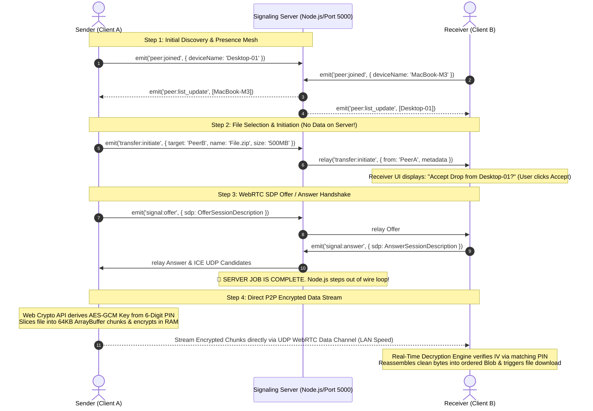
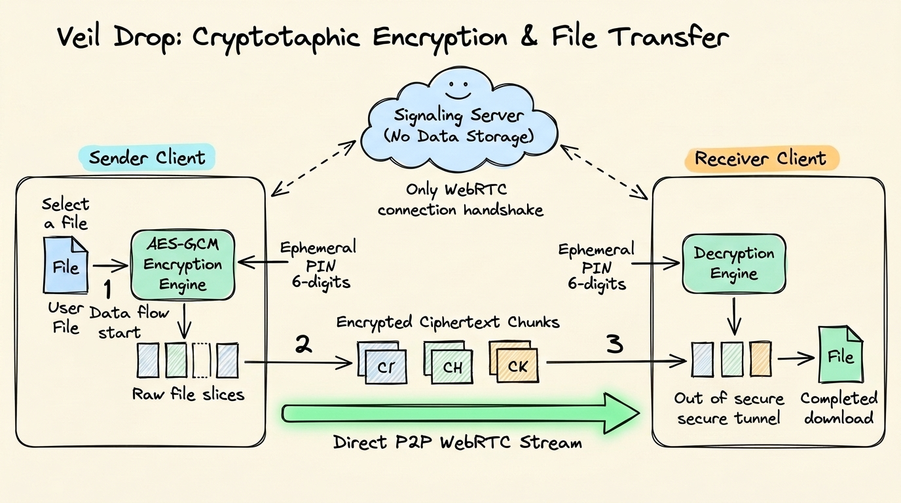

# 🏛️ Veil Drop Architecture & Nomenclature Specification

> This specification documents the system boundaries, design patterns, networking protocols, and clean code nomenclature that govern **Veil Drop**.

---

## 1. System Topology & Data Flow Diagram

Veil Drop relies on a robust hybrid network architecture. Below is the visual architectural diagram showing how our real-time discovery engine and peer-to-peer data transmission operate seamlessly without server payload retention:

### Key Phases in the Flow:
1. **Signaling Server (Node.js/Socket.IO on Port 5000)**: Acts exclusively as an introduction rendezvous point. It broadcasts device presence and relays WebRTC session descriptions (ICE candidates, SDP offers, and answers). **No actual file payloads ever pass through or reside on this server.**
2. **Client Peers (React/Vite on Port 5173)**: Once handshaken via the signaling server, clients establish a direct, peer-to-peer (P2P) UDP/SCTP WebRTC Data Channel for ultra-fast file chunk streaming.

### 🔄 Deep-Dive: Under-the-Hood Sequence Flow

Below is the complete step-by-step chronology of arrows and operations from the moment a file is dropped to final download completion:

---

## 2. Code Nomenclature & Coding Standards

To maintain industry-standard craftsmanship, all code inside this repository follows strict structural conventions:

### A. File & Component Naming
- **React Components**: `PascalCase` (e.g., `RadarStage.jsx`, `TransferMonitor.jsx`, `Header.jsx`).
- **Hooks & Services**: `camelCase` starting with explicit domain identity (e.g., `usePeers.js`, `socketService.js`).
- **CSS / Styling Files**: `camelCase` or descriptive domain names (e.g., `designSystem.css`).

### B. Variable & Function Nomenclature
- **Variables & Functions**: `camelCase` with intention-revealing names (e.g., `activeTransfers`, `initiateBeam()`, `generateEphemeralPin()`).
- **Constants & Configuration Keys**: `SCREAMING_SNAKE_CASE` (e.g., `CONFIG.PORT`, `EVENTS.PEER_JOINED`).
- **Boolean Flags**: Prefix with `is`, `has`, or `can` (e.g., `isConnected`, `hasEncryptionEnabled`, `canTransmit`).

### C. Folder Structure Responsibilities
- `client/src/components/`: Pure presentation and UI interaction logic only. Must not directly access raw WebSockets; delegate communication to custom hooks or services.
- `client/src/hooks/`: Custom React hooks acting as connectors between UI lifecycle and background service logic.
- `client/src/services/`: Stateless or framework-agnostic client engines (Socket networking, WebRTC peer connections, cryptographic shims).
- `server/src/controllers/`: Handle stateless request logic and network interrogations.
- `server/src/services/`: Stateful event orchestrators (Socket.IO rooms and active peer registry).

---

## 3. WebSocket Event Matrix

All signaling communication occurs via typed event string identifiers defined in `server/src/config/constants.js`:

| Event Identifier | Direction | Payload Description |
| :--- | :--- | :--- |
| `connection` | Client → Server | Initial WebSocket establishment socket handshake. |
| `peer:joined` | Bi-directional | Announces a new device entering the localized mesh. |
| `peer:left` | Server → Client | Broadcasts device termination or disconnection. |
| `peer:list_update` | Server → Client | Dispatches active directory of nearby available nodes. |
| `signal:offer` | Client ↔ Client | WebRTC SDP offer relayed through server. |
| `signal:answer` | Client ↔ Client | WebRTC SDP answer returning to offerer. |
| `signal:ice_candidate`| Client ↔ Client | UDP NAT traversal networking coordinates. |

---

## 4. Security & Encryption Standard ("The Veil")

Below is the detailed step-by-step visual workflow explaining how file selection, cryptographic slicing, direct transmission, and decryption occur when **Veil Privacy Mode** is enabled:

When **Veil Privacy Mode** is active:
1. **Slicing**: Prior to transmission, the selected file Blob is partitioned into lightweight `ArrayBuffer` slices.
2. **Encryption**: An ephemeral initialization vector (`IV`) and cryptographic key are derived using JavaScript's native **Web Crypto API** (`AES-GCM` algorithm) locked to an ephemeral verification PIN.
3. **P2P Streaming**: Chunks are streamed in ciphertext over direct WebRTC UDP channels.
4. **Decryption & Assembly**: The receiving peer authenticates and decrypts incoming payloads using the matching ephemeral verification PIN before reconstructing the original file Blob.
