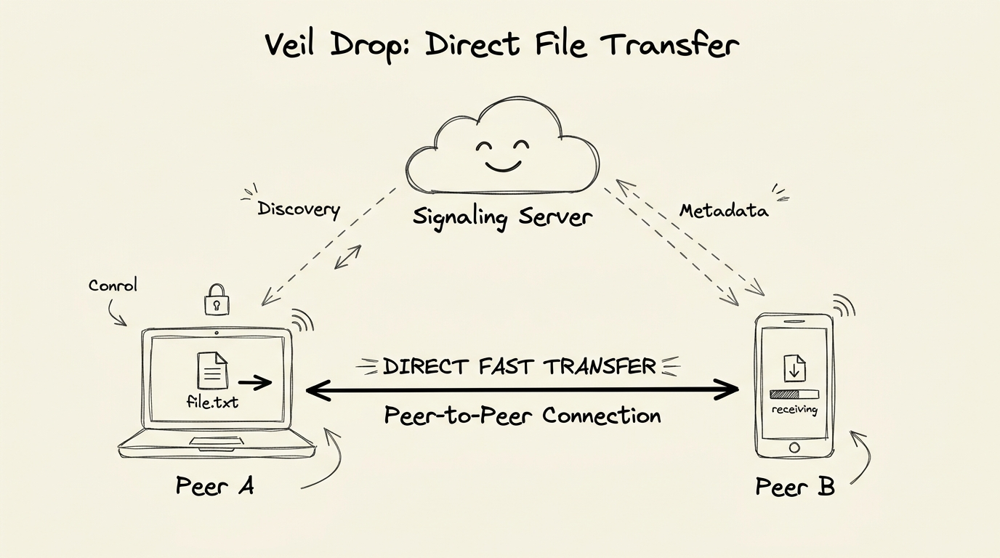

# Veil Drop

> **An industry-standard, clean architecture localized file-transfer & real-time discovery platform inspired by Beam.**  
> Designed with separation of concerns, modular components, and top-notch code splitting.

---

## 🏛️ System Architecture Overview



Veil Drop uses a modern monorepo architecture separating the **React (Vite)** frontend client from the **Node.js / Socket.IO** real-time signaling backend.

```
veil-drop/
├── client/                     # Frontend SPA (React + Vite)
│   ├── src/
│   │   ├── assets/             # Icons, illustrations, and styling assets
│   │   ├── components/         # Domain-driven UI modules & code-split views
│   │   │   ├── common/         # Generic UI design system primitives (GlassPanels, Badges)
│   │   │   ├── radar/          # Interactive Peer Discovery Orbit & Drag-n-Drop stage
│   │   │   ├── transfers/      # Real-time active transmission bars and history vault
│   │   │   └── security/       # Ephemeral encryption codes & privacy mesh toggles
│   │   ├── hooks/              # Custom abstraction hooks (useWebSocket, useFileTransfer)
│   │   ├── services/           # Centralized API and web socket client managers
│   │   ├── styles/             # Vanilla CSS design tokens (HSL colors, glassmorphism)
│   │   └── utils/              # Pure utility helpers (file formatters, crypto shims)
│   └── package.json
│
├── server/                     # Real-time Signaling & Discovery Backend (Node + Express + Socket.io)
│   ├── src/
│   │   ├── config/             # Application environment parameters & networking constants
│   │   ├── controllers/        # Route controllers and peer session handlers
│   │   ├── middlewares/        # Security cors policies, logging, and error interception
│   │   ├── routes/             # API Router definitions
│   │   ├── services/           # Socket.IO orchestration and Local Mesh tracking service
│   │   ├── utils/              # Structured logging and network interface discovery
│   │   └── server.js           # Server application bootstrap entry point
│   └── package.json
```

---

## 🔑 Key Architectural Principles & Nomenclature
- **Separation of Concerns**: UI rendering logic is decoupled from state synchronization and network protocols via custom hooks (`hooks/`) and abstraction layers (`services/`).
- **Domain-Driven Design**: Components are organized by practical functionality (`radar/`, `transfers/`, `security/`) rather than flat dumping, enabling straightforward extensibility and effortless code splitting.
- **Top-Notch Aesthetics**: Implements high-end dark glassmorphism, dynamic glow rings, and responsive animations using strict CSS custom variables without reliance on bloated frameworks.
- **Documentation & Logging**: Every submodule includes clear documentation headers explaining intentionality and structural interfaces.

---

## 🚀 Getting Started (Development Setup)

### 1. Initialize Backend Server
```bash
cd server
npm install
npm run dev
```
*Server runs on `http://localhost:5000` by default and exposes WebSocket signaling for discovery.*

### 2. Initialize Frontend Client
```bash
cd client
npm install
npm run dev
```
*Client opens on `http://localhost:5173` with full real-time networking connection.*
